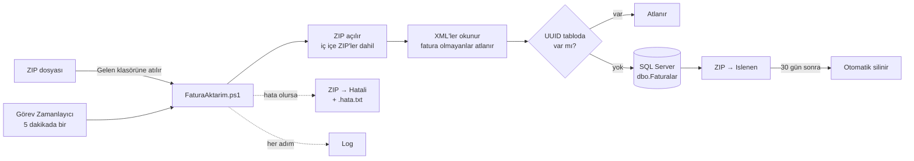

# FaturaAktarim

e-Fatura / e-Arşiv **ZIP dosyalarını** otomatik açıp içindeki UBL-TR XML faturalarını **SQL Server tablosuna** yazan küçük bir Windows aracı.

ZIP'i `Gelen` klasörüne atarsınız, program gerisini halleder. Ek kurulum gerekmez (Windows'ta hazır gelen PowerShell 5.1 ile çalışır).

---

## Nasıl çalışıyor?



1. **ZIP'i bul** – `Gelen` klasöründeki ZIP'leri alır. Son 20 saniyede değişen (kopyalanması bitmemiş) ZIP'i bir sonraki tura bırakır.
2. **Aç** – ZIP'i geçici klasöre açar. XML'ler kökte, alt klasörlerde ya da ZIP içindeki ZIP'te olabilir.
3. **Oku** – Her XML'den fatura başlığını (no, tarih, satıcı, alıcı, toplamlar, vergiler) ve kalemleri çıkarır.
4. **Tekrar kontrolü** – Tabloda aynı **UUID**'li fatura varsa atlar. Aynı ZIP iki kez atılsa da çift kayıt olmaz.
5. **Yaz** – Yeni kalemleri tek seferde (SqlBulkCopy) ve **tek işlem (transaction)** olarak yazar: ya hepsi yazılır ya hiçbiri.
6. **Taşı** – Başarılı ZIP `Islenen`'e, hatalı ZIP `Hatali`'ya gider; dosya adının başına işlenme zamanı eklenir (`20261127_094208_efatura.zip`). Hatanın sebebi yanındaki `.hata.txt`'de ve log'da yazar.
7. **Temizle** – Her çalışmada `Islenen`'deki **30 günden eski** ZIP'ler silinir (bkz. [Saklama süreleri](#saklama-süreleri)).

## Klasör yapısı

```
FaturaAktarim/
├── FaturaAktarim.ps1      # Programın kendisi
├── Calistir.bat           # Elle çalıştırmak için (çift tık)
├── Zamanlayici_Kur.ps1    # Otomatik çalışma (Görev Zamanlayıcı) kurulumu
├── ayarlar.ornek.json     # Ayar şablonu → ayarlar.json olarak kopyalanır
├── ayarlar.json           # Sizin sunucu / veritabanı bilgileriniz (git'e girmez)
├── BENIOKU.txt            # Ayrıntılı kullanım notları
│
│   Çalışma klasörleri: pakette boş gelir, içerikleri git'e girmez
├── Gelen/                 # ZIP'leri buraya atın
├── Islenen/               # Başarıyla aktarılan ZIP'ler  → 30 gün sonra silinir
├── Hatali/                # Aktarılamayan ZIP'ler + .hata.txt  → varsayılan: silinmez
├── Log/                   # aktarim_YYYY-AA.log
└── Gecici/                # Açma sırasında kullanılan geçici klasör (kendini temizler)
```

## Saklama süreleri

İşi biten ZIP'ler sonsuza kadar birikmesin diye program her çalışmada eski dosyaları temizler. Süreler `ayarlar.json`'dan ayarlanır (gün; `0` = hiç silme):

| Ayar | Varsayılan | Ne yapar |
|---|---|---|
| `IslenenSaklamaGun` | `30` | `Islenen`'deki ZIP'ler aktarıldıktan 30 gün sonra silinir. Veriler SQL tablosunda kalır. |
| `HataliSaklamaGun` | `0` | `Hatali`'daki ZIP'ler incelenmesi gerektiği için varsayılan olarak **silinmez**. |

- Süre, dosyanın adındaki **işlenme zamanından** hesaplanır (kopyalanma tarihinden değil).
- Sadece programın kendi taşıdığı dosyalar (adı `yyyyMMdd_HHmmss_` ile başlayanlar) silinir; klasöre elle koyduğunuz dosyalara dokunulmaz.
- `-Deneme` modunda hiçbir şey silinmez; neyin silineceği log'a yazılır.
- Yarıda kalmış çalışmalardan `Gecici`'de kalan klasörler 1 gün sonra temizlenir.
- Ayar dosyanızda bu anahtarlar yoksa varsayılanlar kullanılır.

## Tablo yapısı

Tek tablo, **her satır = 1 fatura kalemi**. Fatura başlık alanları (`Fat...` ile başlayanlar, satıcı, alıcı vb.) o faturanın her kaleminde tekrar eder.

| Grup | Kolonlar |
|---|---|
| Fatura | Klasor, DosyaAdi, FaturaNo, UUID, Profil, FaturaTipi, Tarih, Saat, ParaBirimi, SatirSayisi, SiparisNo, SiparisTarihi, IcBelgeNo, SaseNo, MotorNo, PlakaNo, AracKm, IadeFaturaNo, IadeFaturaTarihi, IstisnaKodu, IstisnaAciklama, Notlar, EkBilgiler |
| Satıcı | SaticiVKN, SaticiUnvan, SaticiAdres, SaticiIlce, SaticiIl, SaticiVergiDairesi, SaticiTel, SaticiEposta |
| Alıcı | AliciKimlikTipi, AliciVKN, AliciUnvan, AliciAdres, AliciIlce, AliciIl, AliciVergiDairesi, AliciTel, AliciEposta |
| Fatura toplamları | FatMalHizmetToplam, FatIskontoToplam, FatVergiHaricTutar, FatVergiDahilTutar, FatOdenecekTutar, FatKDV, FatOTV, FatTevkifat, FatTevkifatOran, FatTevkifatKodu |
| Kalem | SatirNo, UrunKodu, UrunAdi, Miktar, Birim, BirimFiyat, SatirTutar, SatirIskontoOran, SatirIskonto, SatirKDVOran, SatirKDV, SatirOTVOran, SatirOTV |

- Program tablonun kolonlarını kendisi okur: kolon sırası önemli değil, `Id IDENTITY` gibi ek kolonlar olabilir, tarih kolonu `DATE` / `DATETIME` / `NVARCHAR` olabilir.
- Tabloda olmayan kolonlar atlanır ve log'a uyarı yazılır. **`UUID` kolonu şarttır.**
- Fatura bazında toplam alırken `FaturaNo`'ya göre gruplayıp başlık alanlarında `MAX` kullanın:

```sql
SELECT FaturaNo, MAX(Tarih) Tarih, MAX(AliciUnvan) Alici, MAX(FatOdenecekTutar) Odenecek, COUNT(*) KalemSayisi
FROM dbo.Faturalar
GROUP BY FaturaNo;
```

### Bilinen kaynak veri özellikleri

- **Tevkifat:** Bazı sistemler `WithholdingTaxTotal/TaxAmount` alanına satıcıda kalan KDV'yi yazıyor; program tevkif edilen tutarı alt kırılımdan alır (`vergi dahil − tevkifat = ödenecek`).
- **ÖTV:** Vergiler adına göre değil GİB vergi koduna göre toplanır (`0015` KDV, `9077` ÖTV), böylece "ÖTV 2.LİSTE" gibi adlar da yakalanır. Araç faturalarında kalem tutarı ÖTV dahildir.
- **Saat:** `08:05:51.0000000+03:00` gibi değerler `08:05:51`'e indirilir.
- **Sayılar** bilgisayarın Türkçe ayarlarından bağımsız (nokta ondalık) okunur.

## İndirme

Hazır paket **[Releases](../../releases/latest)** sayfasında: `FaturaAktarim-vX.Y.Z.zip` dosyasını indirip açın.
Paketin içinde ayar dosyası (`ayarlar.json`) yoktur; şablondan oluşturulur (aşağıya bakın).

> İndirdiğiniz ZIP'i açmadan önce sağ tık → **Özellikler** → altta **Engellemeyi kaldır** işaretleyin. Windows internetten inen dosyaları işaretler; bu adım olası güvenlik uyarılarını önler.

## Kurulum

1. Paketi (veya klasörü) kalıcı bir yere açın (örn. `C:\FaturaAktarim`).
2. `ayarlar.ornek.json` dosyasını **`ayarlar.json`** adıyla kopyalayıp doldurun:

   | Alan | Açıklama |
   |---|---|
   | `Sunucu` | SQL Server adresi |
   | `Veritabani` | Veritabanı adı |
   | `Tablo` | Tablo adı (örn. `dbo.Faturalar`) |
   | `WindowsKimlik` | `true` → Windows oturumuyla bağlanır (önerilen). `false` → `Kullanici` / `Sifre` ile |
   | `AnaKlasor` | Boşsa programın yanındaki `Gelen`/`Islenen`/... klasörleri kullanılır |
   | `IslenenSaklamaGun` | İşlenen ZIP'lerin kaç gün saklanacağı (varsayılan `30`, `0` = silme) |
   | `HataliSaklamaGun` | Hatalı ZIP'lerin kaç gün saklanacağı (varsayılan `0` = silme) |

3. Deneme (SQL'e yazmadan sadece sayar): `Gelen`'e bir ZIP atın, 20 sn bekleyin:
   ```powershell
   .\Calistir.bat -Deneme
   ```
4. Gerçek aktarım: `Calistir.bat`'a çift tıklayın.
5. Otomatik çalışma (5 dakikada bir):
   ```powershell
   powershell -ExecutionPolicy Bypass -File .\Zamanlayici_Kur.ps1
   ```
   Oturum kapalıyken de çalışsın: `-OturumKapaliykenDe` · Süre: `-Dakika 10` · Kaldırmak: `-Kaldir`

## Güvenlik notları

- `ayarlar.json` ve `Gelen` / `Islenen` / `Hatali` / `Log` klasörleri **`.gitignore`'da**: sunucu bilgileri ve fatura verileri (kişi adları, TCKN'ler) repoya girmez.
- SQL kullanıcısı kullanacaksanız sadece bu tabloya yazma yetkisi olan ayrı bir kullanıcı açın; şifre `ayarlar.json`'da açık durur.
- XML'ler dış kaynak çözümlemesi kapalı (`XmlResolver = null`) okunur.

## Sürümler

| Sürüm | Değişiklik |
|---|---|
| [v1.1.0](../../releases/tag/v1.1.0) | Çalışma klasörleri pakette hazır gelir. İşlenen ZIP'ler 30 gün sonra otomatik silinir (`IslenenSaklamaGun`); hatalı ZIP'ler için isteğe bağlı süre (`HataliSaklamaGun`); yarım kalan geçici klasörlerin temizliği |
| [v1.0.0](../../releases/tag/v1.0.0) | İlk sürüm: ZIP → SQL aktarımı, UUID ile tekrar kontrolü, tek işlem (transaction), deneme modu, Görev Zamanlayıcı kurulumu |

## Gereksinimler

- Windows 10/11 veya Windows Server, PowerShell 5.1 (Windows ile gelir)
- SQL Server 2012 ve üzeri (SQL Server 2019 ve 2025 ile test edildi)
